<!-- markdownlint-disable MD013 MD033 MD041 -->

<a href="https://harperz9.github.io/">
  <picture>
    <source media="(prefers-color-scheme: dark)" srcset="docs/art/hero-dark.svg">
    <source media="(prefers-color-scheme: light)" srcset="docs/art/hero-light.svg">
    
  </picture>
</a>

<p>
  <a href="https://github.com/HarperZ9/flywheel/releases/latest"></a>
  <a href="https://github.com/HarperZ9/articulate/releases/latest"></a>
  <a href="https://github.com/HarperZ9/cmmns/releases/latest"></a>
  <a href="https://github.com/HarperZ9/superframe/releases/latest"></a>
  <a href="https://github.com/HarperZ9/buildlang/releases/latest"></a>
  <a href="https://harperz9.github.io/publications.html"></a>
</p>

I'm Zain Dana Harper. I build software you run on your own machine: it checks
what an AI model did, shows where the replies in a thread come from, checks
your prose line by line, and turns a sentence into a painting, a page of type
and a sound from one seed.

I am a natural philosopher and toolmaker.

I came to software after eleven years of production arboriculture. I have
programmed on my own for about thirteen years and have no professional
programming experience yet.
I love trees, archaeology, geology, geography and paleontology.
Since September 2026 I have worked as a sole proprietor from Kent, Washington. I am looking for roles in AI evaluation and
developer tooling.

## What I stand for

Knowledge has no owner, so I publish methods, data and failures openly. People
who admit an honest error should have a way back. If I play for any side, it is
humanity's.

## Six platforms, one stack

| Platform | What it does for you | Start |
| --- | --- | --- |
| **THE FLYWHEEL** | Run AI tasks on any model and keep a record you can recheck offline. | [Flywheel](#the-flywheel) |
| **ARTICULATE** | Check your writing on your own computer, with each finding tied to its line. | [Articulate](#articulate) |
| **THE COMMONS** | See where social media replies come from while you read a thread. | [CMMNS](#the-commons) |
| **THE PLAYGROUND** | Describe a piece in words and render it as paint, type, lines, sound and touch. | [The Playground](#the-playground) |
| **BUILDLANG** | Write programs whose function types list their side effects, and documents with no TeX install. | [BuildLang](#buildlang) |
| **RESEARCH** | Read the papers and essays. | [Research](https://harperz9.github.io/research.html) |


### The Flywheel

<a href="https://harperz9.github.io/flywheel.html">
  <picture>
    <source media="(prefers-color-scheme: dark)" srcset="docs/art/verdicts-dark.svg">
    <source media="(prefers-color-scheme: light)" srcset="docs/art/verdicts-light.svg">
    
  </picture>
</a>

```text
python -m pip install flywheel-verify
flywheel gate
```

[Flywheel](https://github.com/HarperZ9/flywheel) puts any model behind one
OpenAI-compatible endpoint on your machine. `flywheel code` runs a coding agent
that asks before it writes or runs anything. `flywheel check-output` compares
the values in an answer with the source that decides them, such as a tax table
or a court calendar. Every step lands on a hash-chained ledger, and a sealed
result can be checked again offline with the Python standard library alone.
`flywheel gate` seals a built-in task with no model or network and checks the
seal.

The one capability comparison on record shows no measured accuracy gain:
verified inference scored 9 of 10 against single-shot 8 of 10, and the 95%
interval for the difference, -0.236 to +0.420, includes zero. That benchmark is
retired, because its two arms shared their first attempt. Flywheel is
source-available under FSL-1.1-MIT.

### Articulate

```text
python -m pip install articulate-writing
articulate check README.md --profile readme --gate
```

[Articulate](https://github.com/HarperZ9/articulate) reads a draft on your
computer and names each writing pattern with the line it sits on: stacked
hedges, marketing words, contrast framing, em dashes. A profile for each kind
of writing decides which findings block, so `--gate` drops into CI or a
pre-commit hook. It needs no model, account or key. Use it to improve writing
and leave authorship to other evidence: on 183 texts of known origin it flagged
57 of 75 human texts as well as all 84 AI texts.

### The Commons

[CMMNS](https://github.com/HarperZ9/cmmns), spoken "commons", is a browser
extension for Chrome, Edge, Brave and Firefox. Rest the pointer on a reply on
X, YouTube, Reddit, Bluesky or five other networks, and a window beside it
shows where the platform places the account, signs of coordination, how the
reply argues, and whether a fact-checker has reviewed the claim. Install it
from the latest release with the
[install guide](https://harperz9.github.io/cmmns/install.html), which checks
your download against a signed checksum file. Release 3.10.0 adds
right-click page saving and a Python analysis layer for saved threads.

### The Playground

```text
git clone https://github.com/HarperZ9/superframe && cd superframe
npm run make -- "heavy rust coral upper left, fine teal frost on the right" out/first --seed first
```

[The Playground](https://github.com/HarperZ9/superframe) (THEPLAYGRND) is the
engine. Superframe, its core, turns a sentence into one seeded recipe and
renders it as paint, living type, line drawing, material, sound and a vibration
pattern. The same words and seed give the same files byte for byte. Each render
also writes a plain-language study of its parts for people and screen readers,
and a JSON study for software. It needs Node 24 or newer.

The repository also holds study tools in `packages/`, the game Low Water in
`games/low-water/`, and in `native/` the C++23 renderer first published as
[raw-native](https://github.com/HarperZ9/raw-native).

### BuildLang

```text
cargo install buildlang
```

[BuildLang](https://github.com/HarperZ9/buildlang) is a compiled language whose
function types list side effects such as file, network and C access. It builds
native binaries through C and emits HLSL and GLSL shaders. Its document layer
sets one source to PDF, SVG and HTML. BuildTeX, released in 1.11.0, adds a
checked build: it reads its own PDF back and fails on overfull lines, missing
glyphs, unembedded fonts or text out of reading order, and it refuses to start
TeX or Lean. A Metamath proof verifier ships with it. The checker meant to
replace Lean is still a design.

Release 1.15.0 adds experimental backends that write x86-64 executables with
no outside toolchain and WebAssembly binary modules.

<details>
<summary><b>Current release of every tool</b> (refreshed daily from GitHub)</summary>

<!-- releases:start -->
| Tool | What it does | Release |
| --- | --- | --- |
| [Flywheel](https://github.com/HarperZ9/flywheel) | Runs AI tasks on any model and keeps a record you can recheck | [v1.9.0](https://github.com/HarperZ9/flywheel/releases/tag/v1.9.0) |
| [Articulate](https://github.com/HarperZ9/articulate) | Checks prose locally and names each pattern and its line | [v0.18.0](https://github.com/HarperZ9/articulate/releases/tag/v0.18.0) |
| [CMMNS](https://github.com/HarperZ9/cmmns) | Browser extension that shows where social media replies come from | [v3.10.0](https://github.com/HarperZ9/cmmns/releases/tag/v3.10.0) |
| [The Playground](https://github.com/HarperZ9/superframe) | Renders a described piece from one seed in every medium | [v0.3.0](https://github.com/HarperZ9/superframe/releases/tag/v0.3.0) |
| [raw-native](https://github.com/HarperZ9/raw-native) | C++23 renderer that measures a fast effect against its reference | [v0.8.0](https://github.com/HarperZ9/raw-native/releases/tag/v0.8.0) |
| [BuildLang](https://github.com/HarperZ9/buildlang) | Compiled language whose function types list their side effects | [v1.15.0](https://github.com/HarperZ9/buildlang/releases/tag/v1.15.0) |
| [Telos](https://github.com/HarperZ9/telos) | MCP server and CLI: web reading, CI triage, browser control you grant | [v0.9.0](https://github.com/HarperZ9/telos/releases/tag/v0.9.0) |
| [Accountable Surface](https://github.com/HarperZ9/accountable-surface) | Lets an agent act only within grants you write | [v0.2.0](https://github.com/HarperZ9/accountable-surface/releases/tag/v0.2.0) |
| [Forum](https://github.com/HarperZ9/forum) | Coordinates agent teams with a replayable ledger | [v1.17.0](https://github.com/HarperZ9/forum/releases/tag/v1.17.0) |
| [Relay](https://github.com/HarperZ9/relay) | Permission-checked coding agent for any model endpoint | [v0.7.0](https://github.com/HarperZ9/relay/releases/tag/v0.7.0) |
| [Gather](https://github.com/HarperZ9/gather) | Research intake with provenance; takes files apart and rebuilds them exactly | [v2.6.0](https://github.com/HarperZ9/gather/releases/tag/v2.6.0) |
| [Index](https://github.com/HarperZ9/index) | Offline repository maps with file and line evidence | [v2.16.0](https://github.com/HarperZ9/index/releases/tag/v2.16.0) |
| [Mneme](https://github.com/HarperZ9/mneme) | Agent memory where every recall can be rechecked | [v0.7.0](https://github.com/HarperZ9/mneme/releases/tag/v0.7.0) |
| [Canon](https://github.com/HarperZ9/canon) | One memory and personality record shared across models | [v0.7.0](https://github.com/HarperZ9/canon/releases/tag/v0.7.0) |
| [Crucible](https://github.com/HarperZ9/crucible) | Tests falsifiable claims and records MATCH, DRIFT or UNVERIFIABLE | [v1.6.0](https://github.com/HarperZ9/crucible/releases/tag/v1.6.0) |
| [EMET](https://github.com/HarperZ9/emet) | Checks that bytes reaching a model still match their source | [v1.3.1](https://github.com/HarperZ9/emet/releases/tag/v1.3.1) |
| [Learn](https://github.com/HarperZ9/learn) | Turns your material into a course and leaves the test to you | [v2.3.0](https://github.com/HarperZ9/learn/releases/tag/v2.3.0) |
| [Plexus](https://github.com/HarperZ9/plexus) | Finds and wires compatible tools in an agent toolchain | [v0.4.0](https://github.com/HarperZ9/plexus/releases/tag/v0.4.0) |
<!-- releases:end -->

</details>

<sub>Verified 14 November 2026: release tags and merged pull requests on the GitHub API; flywheel-verify 1.9.0 and articulate-writing 0.18.0 on PyPI; buildlang 1.15.0 on crates.io; the Flywheel and Articulate figures in each README; the writing list in the site feed.</sub>


## Writing and investigations

<a href="https://harperz9.github.io/who-knew-first.html">
  <picture>
    <source media="(prefers-color-scheme: dark)" srcset="docs/art/incidents-dark.svg">
    <source media="(prefers-color-scheme: light)" srcset="docs/art/incidents-light.svg">
    
  </picture>
</a>

[Who Knew First](https://harperz9.github.io/who-knew-first.html) records nine
2026 incidents in which an AI agent crossed a boundary. In six of them, someone
outside the organization that ran the model told the public first.
[The series](https://harperz9.github.io/who-knew-first-series.html) follows the
questions that raises.
Each piece lists its sources and the confidence of each claim. An
Anthropic-built model helped compile them, and Anthropic appears in the record,
so each piece marks where Anthropic is a party.

| Piece | The question | Published |
| --- | --- | --- |
| [Who Pays the Referees](https://harperz9.github.io/who-pays-the-referees.html) | The people who check AI models depend on the labs they check. Which of those terms are public? | 1 October 2026 |
| [The Terms for Telling](https://harperz9.github.io/the-terms-for-telling.html) | The party that holds the records also writes the contracts of the people who could tell. Who got heard? | 1 October 2026 |
| [Who Kept the Books](https://harperz9.github.io/who-kept-the-books.html) | In money cases from 1514 to Iran-Contra, what made the first account move? | 8 October 2026 |
| [The Maker Is Part of the Story](https://harperz9.github.io/the-maker-is-part-of-the-story.html) | Three famous stories, read for who funds the work and who edits the record. | 8 October 2026 |
| [A Check It Cannot Predict](https://harperz9.github.io/a-check-it-cannot-predict.html) | Does a check that is certain and outside the actor's control work on AI models too? | 8 October 2026 |

The [publications page](https://harperz9.github.io/publications.html) lists the
essays, briefings and papers.

<details>
<summary><b>Latest writing</b> (refreshed daily from the site feed)</summary>

<!-- writing:start -->
| Date | Piece |
| --- | --- |
| 2026-10-08 | [Who Kept the Books](https://harperz9.github.io/who-kept-the-books.html) |
| 2026-10-08 | [The Maker Is Part of the Story](https://harperz9.github.io/the-maker-is-part-of-the-story.html) |
| 2026-10-08 | [A Check It Cannot Predict](https://harperz9.github.io/a-check-it-cannot-predict.html) |
| 2026-10-02 | [A Bullshitter Knows a Bullshitter](https://harperz9.github.io/why-i-do-this.html) |
| 2026-10-01 | [Who Pays the Referees](https://harperz9.github.io/who-pays-the-referees.html) |
| 2026-10-01 | [The Terms for Telling](https://harperz9.github.io/the-terms-for-telling.html) |
<!-- writing:end -->

</details>

<details>
<summary><b>Work accepted upstream</b></summary>

I sent 82 pull requests to 66 outside projects: 41 merged, 20 open, 21 closed
without merge (GitHub API, 14 November 2026). Three merged ones are list entries.
Merged examples:

- [Datasette PR 2815](https://github.com/simonw/datasette/pull/2815): malformed row URLs return HTTP 400.
- [AgentFence PR 261](https://github.com/dgenio/agentfence/pull/261): rule lookup without per-call sorting.
- [Mergewarden PR 107](https://github.com/sjh9714/mergewarden/pull/107): workflow-pinning replay fixtures.
- [Free Law Project PR 820](https://github.com/freelawproject/litigant-portal/pull/820): fast-test documentation.

The [portfolio](https://harperz9.github.io/portfolio.html) lists all 82.

</details>


## Work with me

I take scoped work on evaluation design review, harness integration, agent
safety review before an audit, and incident review. Each quote comes from the
labor, time, compute and tooling the job needs.
I have no paid client today and no current sponsors.
The evaluation tooling is built to serve embedded evaluation at frontier AI
labs, and no pilot or engagement with any lab has begun.

<details>
<summary><b>Independence rules</b></summary>

- Income from this work is published with its exact source, API credits included.
- When one source passes 15 percent of income over twelve months, I disclose it and give my findings about that party a second review.
- At 50 percent, I decline new work evaluating that party. A first contract is most of the income by arithmetic, so it is disclosed in full and the decline rule waits for the second.
- One standard for every lab. I build with Anthropic and OpenAI models and publish investigations that name both.

</details>

<details>
<summary><b>Roles and paths</b></summary>

I'm open to technical and nontechnical roles in AI governance and evaluation,
and willing to relocate to London or travel to San Francisco.

| Path | Where I fit | Start here |
| --- | --- | --- |
| **Technical and evaluation** | Agent and model evaluation, developer tooling, CI, security testing, technical support and documentation. | [Engineering path](https://harperz9.github.io/hire.html#engineering-path) |
| **Public service and field** | Public service, facilities, parks and grounds, arboriculture, scheduling and safety judgment, from eleven years of field work. | [Public-service and field path](https://harperz9.github.io/hire.html#public-service-field-path) |
| **Education and research** | Fellowships, research operations and evidence-centered technical writing. | [Research](https://harperz9.github.io/research.html) |

[Resume](https://harperz9.github.io/resume.html) ·
[CV](https://harperz9.github.io/cv.html) ·
[Portfolio](https://harperz9.github.io/portfolio.html)

</details>

## Reach me

- Email: [zaindharper@gmail.com](mailto:zaindharper@gmail.com)
- Site: [harperz9.github.io](https://harperz9.github.io/)
- LinkedIn: [zaindanaharper](https://www.linkedin.com/in/zaindanaharper/)
- Writing feed: [feed.xml](https://harperz9.github.io/feed.xml)

<sub>The art on this page is generated by <code>scripts/profile_art.py</code>. Motion stops when your system asks for reduced motion.</sub>
