<!-- markdownlint-disable MD013 MD033 MD041 -->

<a href="https://harperz9.github.io/">
  <picture>
    <source media="(prefers-color-scheme: dark)" srcset="docs/art/hero-dark.svg">
    <source media="(prefers-color-scheme: light)" srcset="docs/art/hero-light.svg">
    
  </picture>
</a>

<p>
  <a href="https://github.com/HarperZ9/flywheel/releases/latest"></a>
  <a href="https://github.com/HarperZ9/articulate/releases/latest"></a>
  <a href="https://github.com/HarperZ9/cmmns/releases/latest"></a>
  <a href="https://github.com/HarperZ9/superframe/releases/latest"></a>
  <a href="https://github.com/HarperZ9/buildlang/releases/latest"></a>
  <a href="https://harperz9.github.io/publications.html"></a>
</p>

I'm Zain Dana Harper, a natural philosopher, independent researcher, and toolmaker.
I came to software after eleven years of Pacific Northwest production arboriculture.
I have programmed on my own for about thirteen years and have no professional programming experience yet.
I love trees, archaeology, geology, geography, and paleontology.
Since September 2026 I have worked as a sole proprietor from Kent, Washington, building verifiable local-first software across 159 public repositories.
I am looking for roles and collaborations in AI evaluation, deterministic compilers, developer tooling, rendering engines, and open science.

[Site](https://harperz9.github.io/) ·
[Playground](https://harperz9.github.io/playground/) ·
[Models](https://harperz9.github.io/models.html) ·
[Tools](https://harperz9.github.io/tools.html) ·
[Security](https://harperz9.github.io/security.html) ·
[Architecture](https://harperz9.github.io/architecture.html) ·
[Research](https://harperz9.github.io/research.html) ·
[Hire / work](https://harperz9.github.io/hire.html) ·
[Resume](https://harperz9.github.io/resume.html) ·
[CV](https://harperz9.github.io/cv.html) ·
[Portfolio](https://harperz9.github.io/portfolio.html)

## What I stand for

Knowledge has no owner, so I publish methods, data, and failures openly, including 12 honest null results across 30 empirical studies.
People who admit an honest error should have a way back.
If I play for any side, it is humanity's.

## Six platforms, one stack

The stack pairs a **Super Accelerator** ([BuildLang](https://github.com/HarperZ9/buildlang), `AGPL-3.0-only`: deterministic compiler, effect types, BuildDB, and checked PDFs) with a **Super Solver** ([Flywheel](https://github.com/HarperZ9/flywheel), `FSL-1.1-MIT`: model-neutral gateway, Three-Plate verification, local GPU RLVR forge, and `engine-receipt/1` trails), alongside [The Playground](https://github.com/HarperZ9/superframe) (`FSL-1.1-MIT`: DX12, Vulkan, WebGPU rendering and physical-AI simulation), [CMMNS](https://github.com/HarperZ9/cmmns) (`AGPL-3.0-only`: site-agnostic archival and offline provenance), [Articulate](https://github.com/HarperZ9/articulate) (`FSL-1.1-MIT`: local prose linting), and [harperz9.github.io](https://harperz9.github.io/) (live browser tools, studies, and career suite).

### 10-Vertical Capabilities and 1-Command Install Matrix

| Vertical | Flagship / Tool | License | 1-Command Start | Live Surface |
| --- | --- | --- | --- | --- |
| 1. Compilers & GPU Backends | [BuildLang](https://github.com/HarperZ9/buildlang) (`buildc` v1.15.0) | `AGPL-3.0-only` | `cargo install buildlang` | [buildlang.html](https://harperz9.github.io/buildlang.html) |
| 2. AI Gateway, Eval & Receipts | [Flywheel](https://github.com/HarperZ9/flywheel) (v2.0.0) | `FSL-1.1-MIT` | `pip install flywheel-verify` | [flywheel.html](https://harperz9.github.io/flywheel.html) |
| 3. Local GPU RLVR Model Forge | [Flywheel](https://github.com/HarperZ9/flywheel) + [Plexus](https://github.com/HarperZ9/plexus) | `FSL-1.1-MIT` | `flywheel gate` (RTX 4090 / Colab) | [models.html](https://harperz9.github.io/models.html) |
| 4. Prose Linting & CI Gates | [Articulate](https://github.com/HarperZ9/articulate) (v0.19.1) | `FSL-1.1-MIT` | `pip install articulate-writing` | [tools.html](https://harperz9.github.io/tools.html) |
| 5. Web & AI Provenance / Archival | [CMMNS](https://github.com/HarperZ9/cmmns) (v3.10.0) | `AGPL-3.0-only` | `curl -fsSL https://raw.githubusercontent.com/HarperZ9/cmmns/main/install.sh \| sh` | [cmmns.html](https://harperz9.github.io/cmmns.html) |
| 6. DX12, Vulkan, WebGPU & Paint | [The Playground](https://github.com/HarperZ9/superframe) (v0.3.0) | `FSL-1.1-MIT` | `curl -fsSL https://raw.githubusercontent.com/HarperZ9/superframe/main/install.sh \| sh` | [playground/](https://harperz9.github.io/playground/) |
| 7. Physical-AI, Optics & Audio | [The Playground](https://github.com/HarperZ9/superframe) / [raw-native](https://github.com/HarperZ9/raw-native) | `FSL-1.1-MIT` | `raw_native_cli` + WebGPU studio | [playground/](https://harperz9.github.io/playground/) |
| 8. MCP Servers & Agent Grants | [Telos](https://github.com/HarperZ9/telos) / [Accountable Surface](https://github.com/HarperZ9/accountable-surface) | `FSL-1.1-ALv2` / `AGPL-3.0-only` | `npx project-telos-mcp` | [security.html](https://harperz9.github.io/security.html) |
| 9. Corpus Intake & Repo Atlas | [Gather](https://github.com/HarperZ9/gather) / [Index](https://github.com/HarperZ9/index) / [Canon](https://github.com/HarperZ9/canon) | `AGPL-3.0-only` / `FSL-1.1-MIT` | `pip install gather-engine index-graph` | [tools.html](https://harperz9.github.io/tools.html) |
| 10. Empirical Research & Audits | [HarperZ9 Studies](https://harperz9.github.io/studies/) (30 studies, 12 nulls) | `CC-BY-4.0` | Offline verification scripts + receipts | [studies/](https://harperz9.github.io/studies/) |

<details>
<summary><b>Verified engineering proofs (Waves 19 to 31, clickable merged PRs)</b></summary>

| Area | Verified result | Merged PR |
| --- | --- | --- |
| BuildLang 12 targets | Added Apple Metal (`msl`), WebGPU (`wgsl`), and `riscv64` backends alongside C, x86-64, WASM, HLSL, and GLSL. | [buildlang#342](https://github.com/HarperZ9/buildlang/pull/342) |
| BuildLang V5 superoptimizer + GPU TV | Certified e-graph superoptimizer (`14/14` tests) and GPU polyhedral translation validation (`10/10` tests). | [buildlang#341](https://github.com/HarperZ9/buildlang/pull/341), [buildlang#344](https://github.com/HarperZ9/buildlang/pull/344), [buildlang#346](https://github.com/HarperZ9/buildlang/pull/346) |
| Universal Hourglass + frontends | Pure-BuildLang lifters (`port/universal/`), Python and controlled plain-English frontends, and BuildTeX hairline anchor. | [buildlang#339](https://github.com/HarperZ9/buildlang/pull/339), [buildlang#340](https://github.com/HarperZ9/buildlang/pull/340) |
| Compiled algorithmic oracles | Near-linear SSSP, fused LoopCD logits, XStack fidelity oracles, and 1-pass Online-Softmax Reverse-KL / NOH-4 kernels. | [buildlang#343](https://github.com/HarperZ9/buildlang/pull/343), [buildlang#336](https://github.com/HarperZ9/buildlang/pull/336) |
| Flywheel Super Solver + Rowan router | Unified local/subscription/API router, 2-stage sanitizer, SAG-Mem, Three-Plate Oracle, `34.99x` Merkle speedup, and Welch PSD detector. | [flywheel#561](https://github.com/HarperZ9/flywheel/pull/561), [flywheel#565](https://github.com/HarperZ9/flywheel/pull/565), [flywheel#566](https://github.com/HarperZ9/flywheel/pull/566), [flywheel#568](https://github.com/HarperZ9/flywheel/pull/568) |
| Local RTX 4090 / Colab forge | `FRESCO` orthogonal LoRA projection, `MoLT` cross-loop KV reuse, `Plato-Key` latent codec, `NOH-4` CODIT, and monotonic Arm C eval. | [flywheel#558](https://github.com/HarperZ9/flywheel/pull/558), [flywheel#562](https://github.com/HarperZ9/flywheel/pull/562), [flywheel#564](https://github.com/HarperZ9/flywheel/pull/564) |
| Playground simulation, optics & RAW | 100 Hz physical-AI simulation, ITU-R BT.2020/2100 optics, WGSL/HLSL `DeltaE 0.0` parity, and RAW Wave 80 (`96/96` checks). | [superframe#149](https://github.com/HarperZ9/superframe/pull/149), [superframe#153](https://github.com/HarperZ9/superframe/pull/153), [superframe#155](https://github.com/HarperZ9/superframe/pull/155) |
| CMMNS page capture & AI provenance | Site-agnostic `cmmns.page/1`, offline Web/AI provenance verifier (`cmmns provenance verify`), and `funding.json`. | [cmmns#126](https://github.com/HarperZ9/cmmns/pull/126), [cmmns#130](https://github.com/HarperZ9/cmmns/pull/130), [cmmns#131](https://github.com/HarperZ9/cmmns/pull/131) |
| Live WebGPU Playground & site hub | Live `/playground/` studio, `/models.html`, `/tools.html`, `/llms.txt`, and fail-closed `SHA256SUMS` installers on all 4 flagships. | [HarperZ9.github.io#585](https://github.com/HarperZ9/HarperZ9.github.io/pull/585), [HarperZ9.github.io#586](https://github.com/HarperZ9/HarperZ9.github.io/pull/586), [buildlang#338](https://github.com/HarperZ9/buildlang/pull/338), [flywheel#560](https://github.com/HarperZ9/flywheel/pull/560) |

</details>


### The Flywheel

<a href="https://harperz9.github.io/flywheel.html">
  <picture>
    <source media="(prefers-color-scheme: dark)" srcset="docs/art/verdicts-dark.svg">
    <source media="(prefers-color-scheme: light)" srcset="docs/art/verdicts-light.svg">
    
  </picture>
</a>

```text
# Fail-closed SHA256SUMS 1-command install (Windows / Linux / macOS)
irm https://raw.githubusercontent.com/HarperZ9/flywheel/main/install.ps1 | iex
curl -fsSL https://raw.githubusercontent.com/HarperZ9/flywheel/main/install.sh | sh

# Or via PyPI
python -m pip install flywheel-verify
flywheel gate
```

[Flywheel](https://github.com/HarperZ9/flywheel) puts any model behind one local OpenAI-compatible gateway with Rowan routing, default-deny grants (`accountable-surface`), multimodal deconstruction (`gather`), Rust `#![forbid(unsafe_code)]` receipt verification (`emet`), and a single-GPU RTX 4090 / Colab model forge (`plexus`).
`flywheel check-output` compares answer values with the deciding source, and every step lands on a hash-chained ledger recheckable offline with Python's standard library alone.

The one capability comparison on record shows no measured accuracy gain: verified inference scored 9 of 10 against single-shot 8 of 10, and the 95% interval for the difference, -0.236 to +0.420, includes zero. That benchmark is retired because its two arms shared their first attempt. Flywheel is source-available under FSL-1.1-MIT.

### Articulate

```text
python -m pip install articulate-writing
articulate check README.md --profile readme --gate
```

[Articulate](https://github.com/HarperZ9/articulate) reads a draft locally and names each writing pattern with its line number: stacked hedges, marketing words, contrast framing, and em dashes.
Profiles let `--gate` run in CI or pre-commit hooks with no model, account, or API key.
Use it to improve prose and leave authorship to other evidence: on 183 texts of known origin it flagged 57 of 75 human texts alongside all 84 AI texts.

### The Commons

```text
# Fail-closed SHA256SUMS 1-command install (MV3 extension + CLI)
irm https://raw.githubusercontent.com/HarperZ9/cmmns/main/install.ps1 | iex
curl -fsSL https://raw.githubusercontent.com/HarperZ9/cmmns/main/install.sh | sh
```

[CMMNS](https://github.com/HarperZ9/cmmns), spoken "commons", is a site-agnostic browser extension and archival tool for Chrome, Edge, Brave, and Firefox.
It captures any webpage (`cmmns.page/1`, Schema.org, RSS/Atom, JSON data islands) and social threads across nine networks into `daylight.sidecar/1` and manifest JSONL records with provenance checks.
Install it with the 1-command `SHA256SUMS` script above or the [install guide](https://harperz9.github.io/cmmns/install.html).

### The Playground

```text
# Fail-closed SHA256SUMS 1-command install (Playground + raw_native_cli)
irm https://raw.githubusercontent.com/HarperZ9/superframe/main/install.ps1 | iex
curl -fsSL https://raw.githubusercontent.com/HarperZ9/superframe/main/install.sh | sh
```

[The Playground](https://github.com/HarperZ9/superframe) (Superframe) renders a seeded recipe into paint, living type, line drawing, material, sound, and touch, plus a plain-language study for screen readers and a JSON study for software.
The repository also holds DX12, Vulkan, and WebGPU engines, the C++23 `native/` renderer ([raw-native](https://github.com/HarperZ9/raw-native) and [RAW](https://github.com/HarperZ9/raw)), `games/low-water/`, ITU-R BT.2020/2100 spectral optics, tree biomechanics, and 6-DOF physical-AI simulation.

### BuildLang

```text
# Fail-closed SHA256SUMS 1-command install (buildc + qdb + port)
irm https://raw.githubusercontent.com/HarperZ9/buildlang/main/install.ps1 | iex
curl -fsSL https://raw.githubusercontent.com/HarperZ9/buildlang/main/install.sh | sh

# Or via Cargo
cargo install buildlang
```

[BuildLang](https://github.com/HarperZ9/buildlang) (`buildc` 1.15.0) is a deterministic systems and GPU language whose function types declare side effects (file, network, C FFI).
It emits native binaries (C, x86-64, RISC-V 64, WebAssembly) and GPU shaders (HLSL, GLSL, WGSL, Apple Metal MSL), ships BuildDB/BuildQL (`qdb`), and includes BuildTeX, which verifies its own PDFs for reading order, embedded fonts, and glyph integrity without TeX or Lean.
A Metamath proof verifier ships with it; the Lean-replacement checker remains a design.

<details>
<summary><b>Current release of every tool</b> (refreshed daily from GitHub)</summary>

<!-- releases:start -->
| Tool | What it does | Release |
| --- | --- | --- |
| [Flywheel](https://github.com/HarperZ9/flywheel) | Runs AI tasks on any model and keeps a record you can recheck | [v2.0.0](https://github.com/HarperZ9/flywheel/releases/tag/v2.0.0) |
| [Articulate](https://github.com/HarperZ9/articulate) | Checks prose locally and names each pattern and its line | [v0.19.1](https://github.com/HarperZ9/articulate/releases/tag/v0.19.1) |
| [CMMNS](https://github.com/HarperZ9/cmmns) | Browser extension that shows where social media replies come from | [v3.10.0](https://github.com/HarperZ9/cmmns/releases/tag/v3.10.0) |
| [The Playground](https://github.com/HarperZ9/superframe) | Renders a described piece from one seed in every medium | [v0.3.0](https://github.com/HarperZ9/superframe/releases/tag/v0.3.0) |
| [raw-native](https://github.com/HarperZ9/raw-native) | C++23 renderer that measures a fast effect against its reference | [v0.8.0](https://github.com/HarperZ9/raw-native/releases/tag/v0.8.0) |
| [BuildLang](https://github.com/HarperZ9/buildlang) | Compiled language whose function types list their side effects | [v1.15.0](https://github.com/HarperZ9/buildlang/releases/tag/v1.15.0) |
| [Telos](https://github.com/HarperZ9/telos) | MCP server and CLI: web reading, CI triage, browser control you grant | [v0.9.0](https://github.com/HarperZ9/telos/releases/tag/v0.9.0) |
| [Accountable Surface](https://github.com/HarperZ9/accountable-surface) | Lets an agent act only within grants you write | [v0.2.0](https://github.com/HarperZ9/accountable-surface/releases/tag/v0.2.0) |
| [Forum](https://github.com/HarperZ9/forum) | Coordinates agent teams with a replayable ledger | [v1.17.0](https://github.com/HarperZ9/forum/releases/tag/v1.17.0) |
| [Relay](https://github.com/HarperZ9/relay) | Permission-checked coding agent for any model endpoint | [v0.7.0](https://github.com/HarperZ9/relay/releases/tag/v0.7.0) |
| [Gather](https://github.com/HarperZ9/gather) | Research intake with provenance; takes files apart and rebuilds them exactly | [v2.6.0](https://github.com/HarperZ9/gather/releases/tag/v2.6.0) |
| [Index](https://github.com/HarperZ9/index) | Offline repository maps with file and line evidence | [v2.16.0](https://github.com/HarperZ9/index/releases/tag/v2.16.0) |
| [Mneme](https://github.com/HarperZ9/mneme) | Agent memory where every recall can be rechecked | [v0.7.0](https://github.com/HarperZ9/mneme/releases/tag/v0.7.0) |
| [Canon](https://github.com/HarperZ9/canon) | One memory and personality record shared across models | [v0.7.0](https://github.com/HarperZ9/canon/releases/tag/v0.7.0) |
| [Crucible](https://github.com/HarperZ9/crucible) | Tests falsifiable claims and records MATCH, DRIFT or UNVERIFIABLE | [v1.6.0](https://github.com/HarperZ9/crucible/releases/tag/v1.6.0) |
| [EMET](https://github.com/HarperZ9/emet) | Checks that bytes reaching a model still match their source | [v1.3.1](https://github.com/HarperZ9/emet/releases/tag/v1.3.1) |
| [Learn](https://github.com/HarperZ9/learn) | Turns your material into a course and leaves the test to you | [v2.3.0](https://github.com/HarperZ9/learn/releases/tag/v2.3.0) |
| [Plexus](https://github.com/HarperZ9/plexus) | Finds and wires compatible tools in an agent toolchain | [v0.4.0](https://github.com/HarperZ9/plexus/releases/tag/v0.4.0) |
<!-- releases:end -->

</details>

<sub>Verified 26 November 2026: merged pull requests and release tags on the GitHub API; flywheel-verify and articulate-writing on PyPI; buildlang 1.15.0 on crates.io; fail-closed SHA256SUMS installers across all four code flagships.</sub>


## Writing and investigations

<a href="https://harperz9.github.io/who-knew-first.html">
  <picture>
    <source media="(prefers-color-scheme: dark)" srcset="docs/art/incidents-dark.svg">
    <source media="(prefers-color-scheme: light)" srcset="docs/art/incidents-light.svg">
    
  </picture>
</a>

[Who Knew First](https://harperz9.github.io/who-knew-first.html) records nine 2026 incidents in which an AI agent crossed a boundary; in six of them, someone outside the operating organization told the public first.
[The series](https://harperz9.github.io/who-knew-first-series.html) follows the governance questions that raises, listing sources, claim confidence, and where Anthropic is a party.

| Piece | The question | Published |
| --- | --- | --- |
| [Who Pays the Referees](https://harperz9.github.io/who-pays-the-referees.html) | The people who check AI models depend on the labs they check. Which of those terms are public? | 1 October 2026 |
| [The Terms for Telling](https://harperz9.github.io/the-terms-for-telling.html) | The party that holds the records also writes the contracts of the people who could tell. Who got heard? | 1 October 2026 |
| [Who Kept the Books](https://harperz9.github.io/who-kept-the-books.html) | In money cases from 1514 to Iran-Contra, what made the first account move? | 8 October 2026 |
| [The Maker Is Part of the Story](https://harperz9.github.io/the-maker-is-part-of-the-story.html) | Three famous stories, read for who funds the work and who edits the record. | 8 October 2026 |
| [A Check It Cannot Predict](https://harperz9.github.io/a-check-it-cannot-predict.html) | Does a check that is certain and outside the actor's control work on AI models too? | 8 October 2026 |

The [publications page](https://harperz9.github.io/publications.html) lists the essays, briefings, and papers.

<details>
<summary><b>Latest writing</b> (refreshed daily from the site feed)</summary>

<!-- writing:start -->
| Date | Piece |
| --- | --- |
| 2026-11-09 | [Findings](https://harperz9.github.io/findings/) |
| 2026-10-08 | [Who Kept the Books](https://harperz9.github.io/who-kept-the-books.html) |
| 2026-10-08 | [The Maker Is Part of the Story](https://harperz9.github.io/the-maker-is-part-of-the-story.html) |
| 2026-10-08 | [A Check It Cannot Predict](https://harperz9.github.io/a-check-it-cannot-predict.html) |
| 2026-10-02 | [A Bullshitter Knows a Bullshitter](https://harperz9.github.io/why-i-do-this.html) |
| 2026-10-01 | [Who Pays the Referees](https://harperz9.github.io/who-pays-the-referees.html) |
<!-- writing:end -->

</details>

<details>
<summary><b>Work accepted upstream (41 merged PRs across 34 repos)</b></summary>

I sent 82 pull requests to 66 outside projects: 41 merged across 34 outside repositories, 20 open, and 21 closed without merge (GitHub API, 14 November 2026). Three merged ones are list entries. Merged examples:

- [Datasette PR 2815](https://github.com/simonw/datasette/pull/2815): malformed row URLs return HTTP 400.
- [grimp PRs 303-305](https://github.com/python-grimp/grimp/pull/303): graph fixes.
- [AgentFence PR 261](https://github.com/dgenio/agentfence/pull/261): unsorted rule lookup.
- [Mergewarden PR 107](https://github.com/sjh9714/mergewarden/pull/107): replay fixtures.
- [Free Law Project PR 820](https://github.com/freelawproject/litigant-portal/pull/820): fast-test docs.

The [portfolio](https://harperz9.github.io/portfolio.html) lists all 82.

</details>


## Work with me

I take scoped work on evaluation design review, harness integration, agent safety review before an audit, and incident review. Each quote comes from the labor, time, compute, and tooling the job needs.
I have no paid client today and no current sponsors.
The evaluation tooling is built to serve embedded evaluation at frontier AI labs, and no pilot or engagement with any lab has begun.

<details>
<summary><b>Independence rules</b></summary>

- Income from this work is published with its exact source, API credits included.
- When one source passes 15 percent of income over twelve months, I disclose it and give my findings about that party a second review.
- At 50 percent, I decline new work evaluating that party. A first contract is most of the income by arithmetic, so it is disclosed in full and the decline rule waits for the second.
- One standard for every lab. I build with Anthropic and OpenAI models and publish investigations that name both.

</details>

<details>
<summary><b>Roles and paths</b></summary>

I'm open to technical and nontechnical roles in AI governance, evaluation, compilers, developer tooling, and open science, and willing to relocate to London or travel to San Francisco.

| Path | Where I fit | Start here |
| --- | --- | --- |
| **Technical and evaluation** | Agent and model evaluation, compilers, rendering, developer tooling, CI, security testing, and documentation. | [Engineering path](https://harperz9.github.io/hire.html#engineering-path) |
| **Public service and field** | Public service, facilities, parks and grounds, arboriculture, scheduling, and safety judgment from eleven years of field work. | [Public-service and field path](https://harperz9.github.io/hire.html#public-service-field-path) |
| **Education and research** | Fellowships, research operations, and evidence-centered technical writing. | [Research](https://harperz9.github.io/research.html) |

[Architecture](https://harperz9.github.io/architecture.html) ·
[Resume](https://harperz9.github.io/resume.html) ·
[CV](https://harperz9.github.io/cv.html) ·
[Portfolio](https://harperz9.github.io/portfolio.html)

</details>

## Reach me

- Email: [zaindharper@gmail.com](mailto:zaindharper@gmail.com)
- Site: [harperz9.github.io](https://harperz9.github.io/)
- LinkedIn: [zaindanaharper](https://www.linkedin.com/in/zaindanaharper/)
- Writing feed: [feed.xml](https://harperz9.github.io/feed.xml)

<sub>The art on this page is generated by <code>scripts/profile_art.py</code>. Motion stops when your system asks for reduced motion.</sub>
